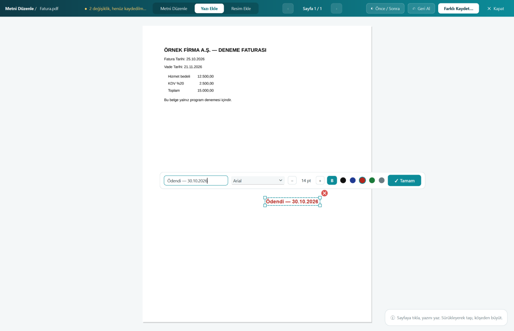

  

<h1 align="center">Erkemoz - PDF Toolkit</h1>

  <b>PDF dosyalarını düzenleyen ve dönüştüren ücretsiz program — Windows</b> 
  <i>Free app to edit and convert PDF files — Windows</i>

  <a href="https://github.com/erkemoz-wq/erkemoz-pdf-toolkit/releases/latest"><b>⬇ Son sürümü indir · Download the latest version</b></a> 
  <code>ErkemozPDFToolkit_Kurulum_x.y.z.exe</code> · Windows 10 / 11 (64-bit) 
  🌐 <a href="https://erkemoz.app/pdf-toolkit/">erkemoz.app</a>

  
  &nbsp;&nbsp;
  
   
  

---

## Türkçe

### Neler yapar
- **Düzenle:** birleştir, böl, sayfa seç, sayfa sil, döndür, sıkıştır, şifre koy, şifre kaldır.
- **Metni Düzenle (yeni):** PDF ekranı kaplayan ayrı bir pencerede tek sayfa halinde açılır. Tarih, tutar gibi bir metne tıkla, yeni halini yaz; belgedeki fontla değişir. **Önce / Sonra** düğmesini basılı tuttukça asıl hali görünür; **Farklı Kaydet** ile yeni dosyaya yazılır.
- **Yazı ve resim ekle (yeni):** sayfanın istediğin yerine yazı koy, fontunu, boyunu, kalınlığını ve rengini seç; kaşe, imza ya da logo ekle, saydam PNG ve opaklık ayarı desteklenir. Eklenenler sürüklenerek taşınır, köşeden büyütülür, × ile silinir.
- **Dönüştür:** PDF'ten Word'e, Excel'e, JPG'ye ve PNG'ye; resimden, Word'den ve Excel'den PDF'e.
- Dosyaları sürükleyip bırakırsın; birleştirmede sırayı listeden ya da numarayı sürükleyerek değiştirirsin.
- Asıl dosyana hiç dokunmaz: her iş yeni bir dosya üretir, aynı adlı dosyanın üzerine yazmaz.
- Ürettiğin her dosya **Çıktılar** sekmesinde kalır. 8 dil, açık ve koyu tema; yeni sürüm çıkınca program haber verir.

### Kurulum
1. Yukarıdaki bağlantıdan kurulum dosyasını indir ve çalıştır.
2. Windows **"Bilgisayarınız korundu"** (SmartScreen) derse **Ek bilgi → Yine de çalıştır**'a tıkla. Bu uyarı, program henüz ücretli bir kod imzalama sertifikasıyla imzalanmadığı için çıkabilir.

### Bilmen gerekenler
- **PDF → Word** için bilgisayarında Microsoft Word kurulu olmalı; dönüştürmeyi Word yapar. **Word → PDF** ve **Excel → PDF** için Microsoft Office ya da ücretsiz LibreOffice yeterli. Öteki araçlar ek program istemez.
- Sıkıştırma, PDF'in içindeki fotoğrafları küçültür; taranmış ve fotoğraflı belgelerde çok, metin ağırlıklı belgelerde az kazandırır.
- Şifre koyduğun PDF'in şifresini unutursan dosya açılamaz; şifre geri getirilemez.
- **Metni Düzenle** belgeye gömülü fontu kullanır. PDF'lere çoğu zaman yalnız kullanılan harfler gömülür; yazdığın harf o gömülü fontta yoksa program değişikliği yapmaz ve hangi harfin eksik olduğunu söyler. Taranmış sayfadaki yazı değiştirilemez. E-imzalı PDF'te değişiklik imzayı geçersiz kılar; program bunu baştan söyler.

### Gizlilik
Belgelerin bilgisayarından çıkmaz; bütün işler bu bilgisayarda yapılır. Program internete yalnız iki iş için bağlanır: yeni sürümü denetlemek için GitHub'a ve açıksa anonim kullanım sayacına. Sayaç yalnızca **rastgele bir kurulum numarası, sürüm ve arayüz dilini** gönderir — açılışta, kapanışta ve program açık kaldıkça 15 dakikada bir; sunucu IP adresini kaydetmez. Ayarlar'daki **"Anonim kullanım sayacı"** kutusunun işaretini kaldırırsan hiçbir şey gönderilmez. Ayrıntılar: [Gizlilik Politikası](https://erkemoz.app/privacy/)

### Güvenlik
- Program makine koduna derlenir ve her açılışta kendi dosyalarının mührünü denetler; değiştirilmiş bir kopya açılmaz. **Yalnızca bu sayfadaki resmi sürümü indir.**
- 🛡 Her sürüm **VirusTotal**'da taranır; raporun linki ve sonucu [sürüm notunda](https://github.com/erkemoz-wq/erkemoz-pdf-toolkit/releases/latest) yazar.
- Açık kaynaklı bileşenler ve lisansları: kurulum klasöründeki `LISANSLAR.txt`. GPL/AGPL lisanslı bileşen kullanılmaz.

---

## English

### Features
- **Edit:** merge, split, select pages, delete pages, rotate, compress, add a password, remove a password.
- **Edit Text (new):** the PDF opens full screen in its own window, one whole page at a time. Click a date, an amount or any other text and type the new version; it's rewritten in the document's own font. Hold **Before / After** to see the original, and **Save As** writes the result to a new file.
- **Add text and images (new):** place text anywhere on the page and pick its font, size, weight and color; add a stamp, signature or logo, with support for transparent PNGs and adjustable opacity. Drag to move anything you add, drag a corner to resize, and click × to remove it.
- **Convert:** PDF to Word, Excel, JPG and PNG; images, Word and Excel to PDF.
- Drag and drop your files; change the merge order in the list or by dragging the row number.
- Your original file is never touched: every task creates a new file and never overwrites a file with the same name.
- Every file you create stays in the **Outputs** tab. 8 languages, light and dark theme; the app tells you when a new version is out.

### Installation
1. Download the installer from the link above and run it.
2. If Windows shows **"Windows protected your PC"**, click **More info → Run anyway**. This can appear because the app is not yet signed with a paid code-signing certificate.

### Good to know
- **PDF to Word** needs Microsoft Word on your computer; Word does the conversion. **Word to PDF** and **Excel to PDF** work with Microsoft Office or the free LibreOffice. All other tools need nothing else.
- Compression shrinks the photos inside the PDF; it saves a lot on scanned and photo-heavy documents and little on mostly-text ones.
- If you forget the password you set on a PDF, the file cannot be opened; the password cannot be recovered.
- **Edit Text** uses the font embedded in the document. PDFs usually embed only the characters they use; if a character you type isn't in that embedded font, the app makes no change and tells you which character is missing. Text on scanned pages can't be changed. Editing a digitally signed PDF invalidates the signature; the app warns you first.

### Privacy
Your documents never leave your computer; all work is done on this PC. The app connects to the internet for only two things: checking GitHub for a new version and, if turned on, the anonymous usage counter. The counter sends only **a random installation ID, the version and the interface language** — at startup, at shutdown and every 15 minutes while the app is open; the server does not store your IP address. Uncheck **"Anonymous usage counter"** in Settings and nothing is sent. Details: [Privacy Policy](https://erkemoz.app/privacy/)

### Security
- The app is compiled to native code and verifies its own files on every start; a modified copy will not run. **Only download the official release from this page.**
- 🛡 Every release is scanned on **VirusTotal**; the report link and result are in the [release notes](https://github.com/erkemoz-wq/erkemoz-pdf-toolkit/releases/latest).
- Open-source components and their licenses: `LISANSLAR.txt` in the installation folder. No GPL/AGPL components are used.

---

☕ Program işine yaradıysa / If it helps you: <a href="https://buymeacoffee.com/erkemoz"><b>Bana bir kahve ısmarla · Buy me a coffee</b></a>

© erkemoz · <a href="mailto:erkemoz@proton.me">erkemoz@proton.me</a> · Ücretsizdir / Free to use · Değiştirilip dağıtılamaz / Do not modify or redistribute

